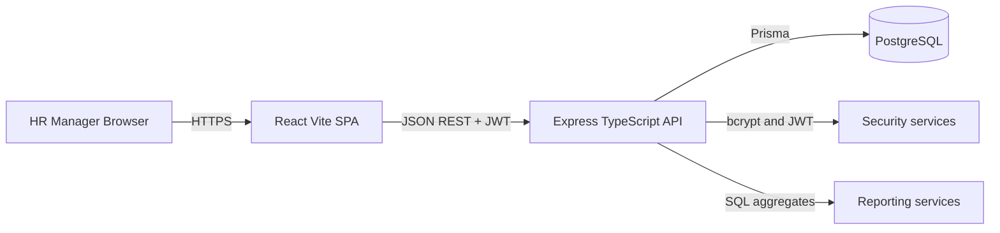

# Architecture

## System architecture

## Frontend structure
- `src/app`: providers, router, API query client, app shell.
- `src/features/auth|employees|salaries|dashboard|reports|audit`: feature-owned components, pages, schemas, and hooks.
- `src/components/ui`: reusable shadcn/Tailwind primitives.
- `src/components/layout`: sidebar, topbar, page shell.
- `src/lib`: HTTP client, formatters, validation helpers.
- `src/test`: setup and shared component tests.

React Router owns page routing; TanStack Query owns server state/cache; React Hook Form plus Zod owns forms and validation. Recharts renders only backend-provided data.

## Backend structure
- `src/config`: environment and app configuration.
- `src/prisma`: client and seed scripts.
- `src/modules/{auth,employees,salaries,dashboard,reports,audit}`: routes, schemas, controllers, services, and repositories.
- `src/middleware`: authentication, authorization, validation, and error handling.
- `src/utils`: currency, date, pagination, and response helpers.
- `src/tests`: unit and integration tests.

Route → middleware/validation → controller → service → repository. Controllers remain transport-focused; domain rules live in services; Prisma queries live in repositories.

## API conventions
- Base path: `/api`.
- JSON response: `{ "data": ..., "meta": ... }` for collections and `{ "data": ... }` for resources.
- Error response: `{ "error": { "code": "...", "message": "...", "details": [] } }`.
- Pagination: `page`, `pageSize`, `total`, `totalPages`, and `hasNext`.
- Date format: ISO-8601; money values serialized as strings in API responses to avoid floating-point loss.
- JWT in Authorization Bearer header.

## Technology choices
- PostgreSQL for referential integrity and aggregation; SQLite may be used only for local/test fallback if Prisma configuration is kept identical.
- Prisma for migrations and type-safe queries.
- Zod on both backend and frontend, with backend validation authoritative.
- Transactions for employee status/salary changes and audit writes.
- Express over heavier frameworks to keep the MVP understandable.
- Recharts for standard dashboard charts and TanStack Table patterns implemented with native semantic HTML if shadcn Table is used.

## Major data flows
- Login: credentials → bcrypt comparison → JWT → protected route middleware.
- Employee query: query validation → indexed repository filters → count and page in one service operation.
- Salary revision: validate no overlap, close current record with effective date, create revision and audit entry in a transaction.
- Dashboard/report: read-only aggregate queries, optional group/currency filters, and backend currency separation.
