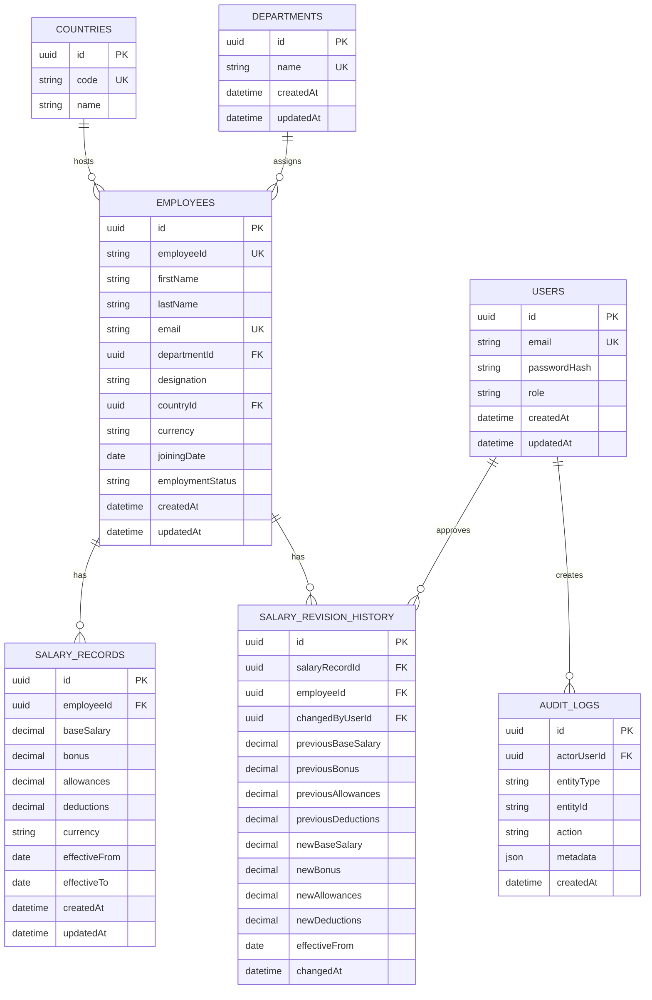

# Database Design

## Core schema

## Relationships and constraints
- Employee belongs to one Department and Country.
- Employee has one or more SalaryRecords, but at most one active record at a given effective date.
- Revision history is append-only and links employee, salary record, and HR actor.
- User role uses an enum-like string; authorization middleware validates a role allowlist.
- All foreign keys use restrict deletion for employee/business records; soft deactivate is preferred.
- Currency is stored on each salary record for historical correctness.

## Indexes
- `employees(employeeId)` unique, `employees(email)` unique.
- `employees(lastName, firstName)`, `employees(countryId)`, `employees(departmentId)`, `employees(employmentStatus)`.
- Composite indexes for employee list filtering and search (country/status/department plus createdAt).
- `salary_records(employeeId, effectiveFrom)`, `salary_records(effectiveFrom/effectiveTo)`, `salary_records(currency)`, and department/country joins via employee indexes.
- `salary_revision_history(employeeId, changedAt)` and `audit_logs(entityType, entityId, createdAt)`.

## Currency rule
No cross-currency exchange-rate table is assumed. Aggregates expose totals grouped by ISO currency. For an explicit organization-wide total without rates, the API should require all active salaries to be represented in a base currency or provide a clear split. The MVP avoids misleading sums and documents the limitation.

## Date and decimal rules
- Dates: `DateTime` or `Date` in UTC/ISO form; effective periods use date-only fields.
- Monetary fields: `Decimal(18,2)` in PostgreSQL.
- Compensation total: base + bonus + allowances - deductions; never derive this in JavaScript with binary floating point.
